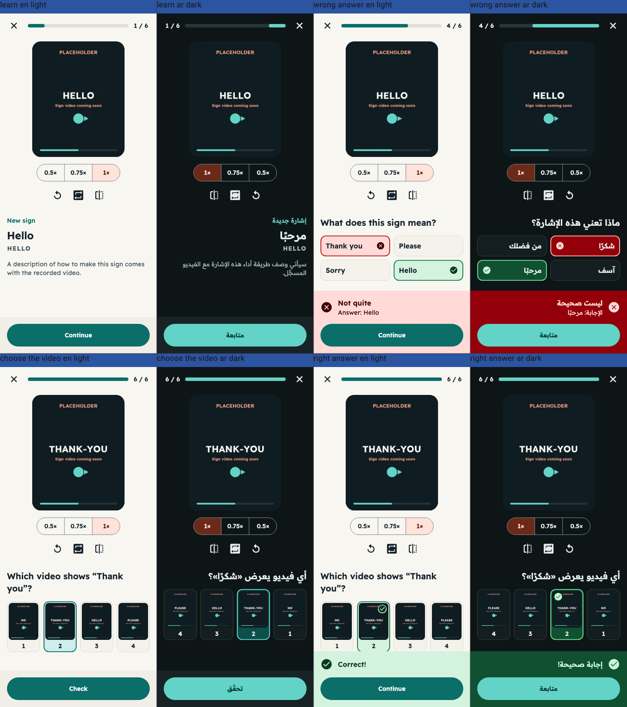
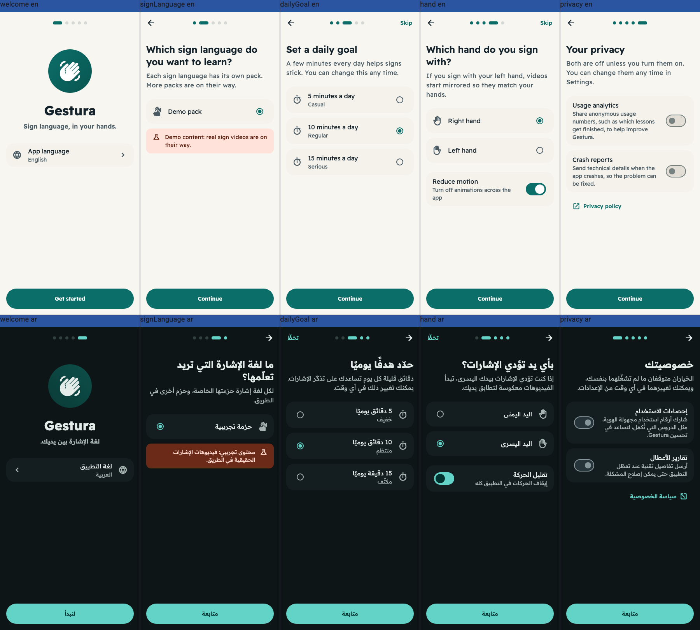
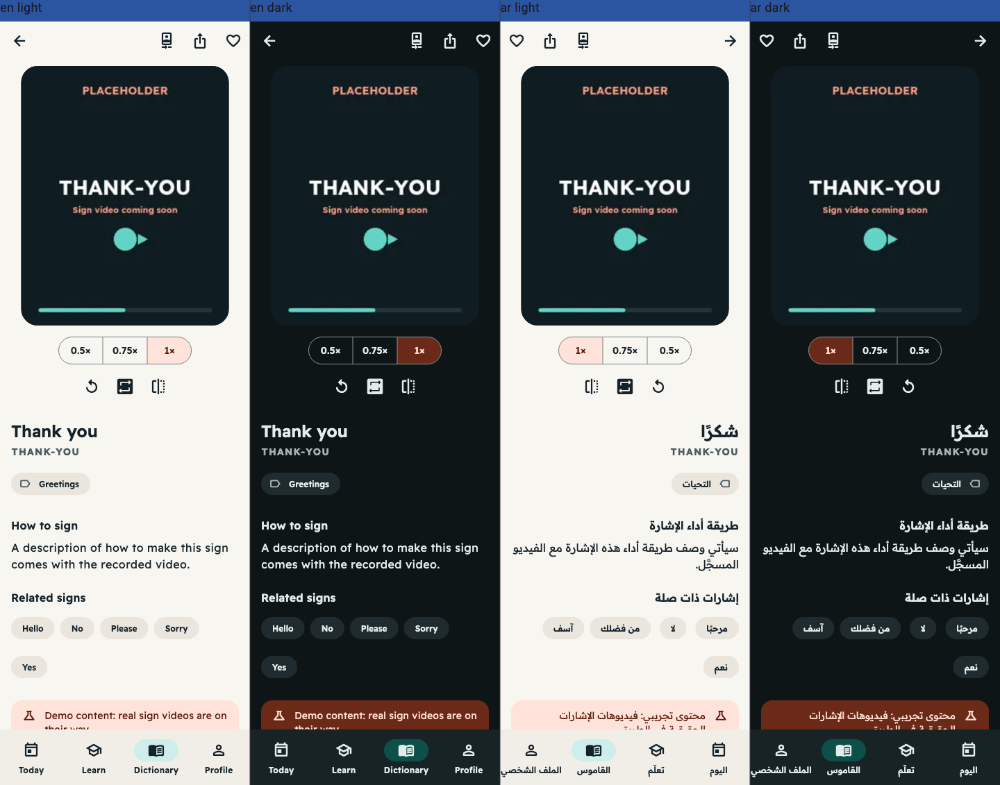
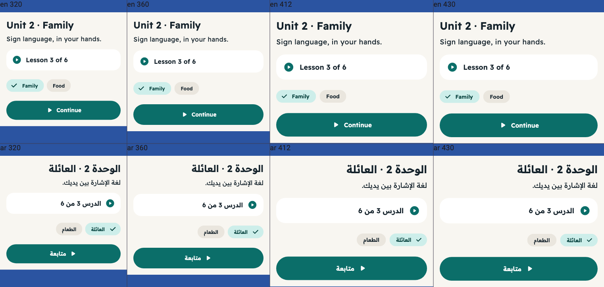
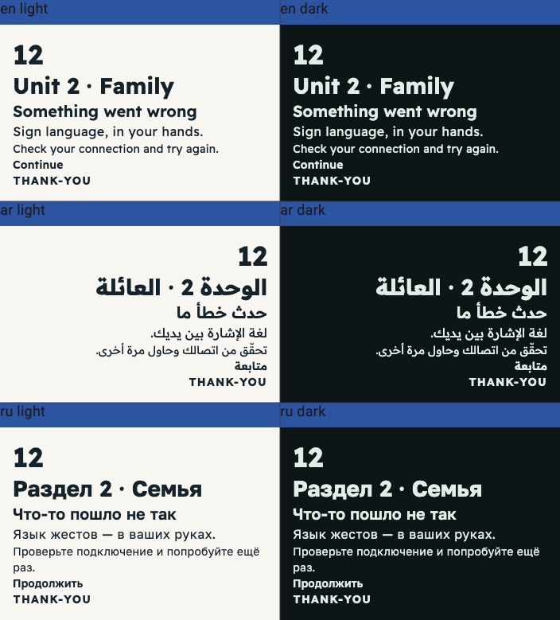

<h1 align="center">Gestura</h1>
<p align="center">Sign language, in your hands.</p>

<p align="center">
  <a href="https://github.com/Ziadabdellah/gestura/actions/workflows/ci.yml"></a>
  
  
  <a href="LICENSE"></a>
</p>

Gestura is a Flutter app for Android and iOS, in development, that will teach the sign language of the European country you live in: short video lessons, spaced-repetition review and a dictionary that works offline. The interface will be available in English, Arabic, Russian, Spanish, French and German.

Every country has its own sign language, and each one is a full language with its own grammar. Gestura is meant as a learning companion, not a replacement for Deaf teachers and communities.

## Status

The project is built in phases. Phases 1 to 3 of the app are complete: learning, review, the dictionary, fingerspelling, practice with the camera, progress, accounts, sync and the release tooling. What is left before the first store release is publishing work: the Play Console listing, the closed test and the real sign videos.

| Part | What it is | Status |
|---|---|---|
| [`packages/gestura_ui`](packages/gestura_ui) | The design system: tokens, themes, fonts, components | Ready |
| [`packages/gestura_core`](packages/gestura_core) | Shared pure Dart logic | Ready |
| [`apps/gestura`](apps/gestura) | The Android and iOS app: three flavors, onboarding, guest, email and Google accounts, lessons, spaced-repetition review, a searchable dictionary, fingerspelling, camera practice, progress and achievements, reminders and cloud sync, in six languages | Ready for the closed test |

## The app so far

<p align="center">
  
</p>

<p align="center">
  
</p>

<p align="center">
  
</p>

<p align="center">
  
</p>

<p align="center">
  
</p>

- **Today** is the first tab: the daily goal with the streak, the next lesson, the signs due for review and a sign of the day.
- **Review** brings learned signs back with spaced repetition (SM-2): watch the sign, show the answer, and grade it again, hard, good or easy; the next date is shown on each button.
- **Onboarding** welcomes a new learner in five short steps: the app language, the sign language pack, a daily goal, the hand they sign with (videos start mirrored for left-handed learners) and privacy, with analytics and crash reports off unless they turn them on.
- **Accounts** start as a guest with one tap. A guest can later continue with Google or create an account with an email address and keep everything, confirm the email, reset a forgotten password, sign out and sign back in, export their data and delete the account.
- **Learn** shows the course and its units, with your progress: each unit folds open to a timeline of lessons that are done (with the best score), up next or locked. A lesson opens when the one before it is finished.
- **Lessons** teach each sign with a looping video (slower speeds, mirror for left-handed learners, replay), then ask what a sign means and which video shows a word. Every answer gets colour, an icon, text and a vibration, and the result is saved to the device.
- **Dictionary** lists the signs from A to Z, filters them by category and searches them in every interface language as you type. Each sign opens on its own page with the video, its controls, its meaning and the related signs; a heart saves it to Saved signs, and Share sends a link that opens the sign in the app.
- **Fingerspelling** shows the alphabet of the pack and spells any word you type, letter by letter.
- **Practice with the camera** puts the sign video above the front camera so learners can copy it while they see themselves. Nothing is recorded.
- **Your progress** shows the streak, best streak, lessons, signs learned and mastered and minutes practised, with nine achievements.
- **Profile** shows the account, and leads to Your progress, Settings (daily goal, daily reminder, theme, language, reduce motion, left-handed signing, privacy, terms), the offline download of every published video, data export and About Gestura.
- Phones get a bottom navigation bar; from 600 dp the app switches to a navigation rail, on the right in Arabic, and keeps lines readable on tablets.

In development builds the lessons, signs and letters come from a bundled demo pack in the six languages. Its videos are generated placeholders, marked as such in the app; production builds only show published content.

## Design system

<p align="center">
  
</p>

The images in this README are the golden files the tests compare against, so they always show the current code.

- **Palette.** A calm blue-green (Lagoon), a warm coral and a sun yellow, in light and dark themes. The brand colors are fixed, and every text and UI color pair is tested against WCAG 2.2 AA contrast.
- **Fonts.** Readex Pro for Latin and Arabic, with Golos Text as the fallback for Cyrillic. Both are bundled with the app, so no font is downloaded at runtime.
- **Adaptive scale.** The whole interface adapts to the phone it runs on, based on the screen's shortest side, so rotating the phone changes nothing:

  | Screen width | Text | Spacing and sizes |
  |---|---|---|
  | 320 dp | 100% | 90% |
  | 360 dp (design size) | 100% | 100% |
  | 412 dp | 112% | 114% |
  | 430 dp and wider | 112% | 115% |
  | Tablets | 100% | 100%, with a different layout instead |

  Text never shrinks below its design size, touch targets never drop below 48 dp, and the user's own text size setting is always applied on top.
- **Components.** `GButton`, `GCard`, `GChip`, `GSkeleton` and `GErrorView`, each with semantics labels, 48 dp touch targets, support for 200% text, reduced motion and right-to-left layouts.

<table>
  <tr>
    <td></td>
    <td></td>
  </tr>
</table>

## Shared logic

`gestura_core` is pure Dart, with no Flutter or Firebase:

- **`Result<T>`** (`Ok` and `Err`) and a sealed **`Failure`** hierarchy, so errors are handled with exhaustive `switch` expressions instead of exceptions.
- **`normalizeForSearch`** for search that ignores Arabic diacritics and hamza forms, folds Arabic-Indic digits, Russian ё and German ß, and collapses whitespace.

## Architecture

A monorepo with pub workspaces and [melos](https://melos.invertase.dev) 8:

```
gestura/
├── pubspec.yaml          workspace and melos scripts
├── apps/
│   └── gestura/          the Android and iOS app
└── packages/
    ├── gestura_core/     pure Dart logic
    └── gestura_ui/       design system
```

- **Flavors.** `dev`, `staging` and `prod` on Android and iOS (Gradle product flavors, Xcode schemes and build configurations), each with its own application ID and name, so all three install side by side on one phone. Dev and staging builds show a corner banner.
- **Languages.** One ARB file per language (English, Arabic, Russian, Spanish, French and German), generated with `gen-l10n`. Tests check that every file has every message and that the plural rules of each language are right, including the six Arabic forms and the Russian ones.

- **MVVM.** Each screen has a View that only renders state and a ViewModel that owns it. Learn, Dictionary, lessons, onboarding and the account forms use Cubit ViewModels with sealed states and are tested with `bloc_test`; every `Failure` maps to a translated message through an exhaustive `switch`, with a retry button. The Settings ViewModel is a Riverpod `Notifier`, on purpose, with a sealed state (`SettingsReady`, `SettingsSaveFailed`): changes apply at once, are saved to the device, and roll back with a message if saving fails. Language, theme and reduce motion change the whole app live.
- **Dependency injection.** get_it and injectable with an environment per flavor; the data layer returns `Result` values instead of throwing.
- **Navigation.** go_router with typed routes generated by go_router_builder, so every screen has a stable address for deep links. The tabs are branches of one `StatefulShellRoute`, so each tab keeps its own history. One redirect, driven by a small gate that listens to the settings and the signed-in user, sends a new learner to onboarding and a signed-out one to the welcome screen.
- **Real content, no fake data in production.** Published sign language packs live on Firebase Hosting as a catalog plus content-hashed media. The production app caches the catalog for offline use and downloads each video only when it is shown, into a size-limited cache. The demo pack is bundled only in development builds, and the publishing tool refuses placeholder content for production.
- **Cloud sync.** Lesson progress, review cards and daily activity stay in Drift and sync to Firestore (EU) for the signed-in learner through one generic `CloudSet<T>` with a codec per type: progress merges by best score, cards by the newest change and activity by the largest count, and only changed items are written. Firestore rules have their own emulator tests in CI.
- **Remote Config.** A minimum build number and a maintenance switch, followed live; old builds are asked to update.
- **Time.** A `Clock` is injected wherever the date matters, so tests and goldens never depend on the day they run.
- **Privacy.** Crash reports and analytics stay off until the learner turns them on; accounts can be deleted and data exported in the app; the camera image never leaves the phone. The privacy policy and the terms of use are published in six languages.
- **Accounts.** Firebase Authentication behind an `AuthRepository` that returns `Result` values and a sealed user (guest or member). A guest becomes a member by linking an email or Google credential, so nothing is lost, and every Firebase error becomes a translated message.
- **Local database.** Progress, review cards, saved signs and daily activity live in [Drift](https://drift.simonbinder.eu) (SQLite), with the tables written in SQL, a tested migration from each schema version, dates in UTC, a saved schema snapshot that a test compares against, and streams that update Learn as soon as a lesson is finished.
- **Content.** A `ContentRepository` returns `Result` values; the bundled pack is parsed in a background isolate with Dart 3 patterns, checked for broken references, and searched in every interface language, ignoring letter case, Arabic diacritics and hamza forms.
- **Integration tests.** Run inside the app on a simulator or device and use the real storage, video player, Firebase Authentication and Firestore (against the local emulators) and the live content site: a guest goes from the very first start through onboarding to a finished lesson and then looks the sign up in the dictionary, progress reaches the cloud and comes back on a new device, the database refuses another learner's progress, deleting an account removes its cloud data, the published catalog and its videos download, a new learner goes through onboarding and starts as a guest, a guest signs up with email, keeps the same account and confirms the email, a member signs out and back in, settings survive a restart, lesson progress survives a database restart, and a learner finishes the first lesson and sees it completed in Learn.


## Quality

- GitHub Actions runs formatting, analysis and every test on each push and pull request, and fails if a comment is added to the code.
- [very_good_analysis](https://pub.dev/packages/very_good_analysis) with `--fatal-infos`: zero warnings and zero infos.
- Unit and widget tests, accessibility guideline tests (tap targets, labels and text contrast) on small phones, large phones and tablets, and at 200% text.
- Golden tests in English and Arabic, in light and dark. macOS goldens are compared on macOS; the CI copies are compared only on Linux and regenerated there by the manual `CI goldens` workflow.
- 100% line coverage in both packages; the app covers every line it owns.

## Getting started

Requirements: [fvm](https://fvm.app). The Flutter version is pinned in [`.fvmrc`](.fvmrc).

```bash
fvm install
fvm flutter pub get
fvm dart run melos run gen --no-select
fvm dart run melos run analyze --no-select
fvm dart run melos run test:dart --no-select
fvm dart run melos run test:flutter --no-select
```

The app also needs its Firebase config, which is not in the repository; see [Firebase setup](#firebase-setup). Then, to run the app on an Android device or an iOS simulator:

```bash
cd apps/gestura
fvm flutter run --flavor dev -t lib/main_dev.dart
```

Integration tests run on a simulator or a device, against the [Firebase Authentication emulator](https://firebase.google.com/docs/emulator-suite) started from the repository root with your development project:

```bash
firebase emulators:start --only auth,firestore --project <dev-project-id>
cd apps/gestura
fvm flutter test integration_test --flavor dev
```

To update the golden files after a UI change (in `apps/gestura` add `--flavor dev`):

```bash
cd packages/gestura_ui
fvm flutter test --tags golden --update-goldens
```

The CI copies under `goldens/ci` are made on Linux: run the **CI goldens** workflow from the Actions tab and copy its artifact into the repository.

## Release tools

| Command | What it does |
|---|---|
| `python3 tool/release_android.py --build-number N` | Signed, obfuscated prod app bundle, and its symbols uploaded to Crashlytics |
| `python3 tool/distribute.py staging --build-number N` | Release APK sent to the testers group in Firebase App Distribution |
| `python3 tool/publish_content.py <dev\|prod> <pack.json> --deploy` | Validates a content pack and publishes it to Firebase Hosting |
| `python3 tool/build_hosting.py` | Builds the privacy, terms, account deletion and app link pages |
| `python3 tool/generate_app_icons.py` | App icons for every flavor and the store icon and feature graphic |
| `fvm flutter test --flavor dev --run-skipped -t store --update-goldens test/store` | Store screenshots in English and Arabic, in `apps/gestura/store/screenshots` |

## Firebase setup

Each flavor talks to Firebase: `dev` and `staging` share a development project, and `prod` has its own. The config files are not in the repository, so create your own two projects, install the [FlutterFire CLI](https://firebase.flutter.dev/docs/cli), and run this from `apps/gestura` for each flavor and each of its iOS build configurations (`Debug-<flavor>`, `Release-<flavor>` and `Profile-<flavor>`, plus the plain `Debug`, `Release` and `Profile` with the `prod` values):

```bash
flutterfire configure \
  --project=<project-id> \
  --platforms=android,ios \
  --out=lib/firebase/firebase_options_<flavor>.dart \
  --android-package-name=<application-id> \
  --android-out=android/app/src/<flavor>/google-services.json \
  --ios-bundle-id=<application-id> \
  --ios-build-config=<build-configuration> \
  --ios-out=ios/flavors/<flavor>/GoogleService-Info.plist
```

The application IDs are `app.gestura.com.dev`, `app.gestura.com.stg` and `app.gestura.com`. In each project, open Authentication → Sign-in method and enable the **Anonymous**, **Email/Password** and **Google** providers (Google needs the SHA-1 and SHA-256 of your signing keys on the Android apps). iOS builds call the FlutterFire CLI from an Xcode build phase, so it must be on your `PATH`.

## License

The code is released under the [MIT License](LICENSE). The Gestura name and logo, the sign language content and the bundled fonts are not covered by it; see [NOTICE.md](NOTICE.md).
