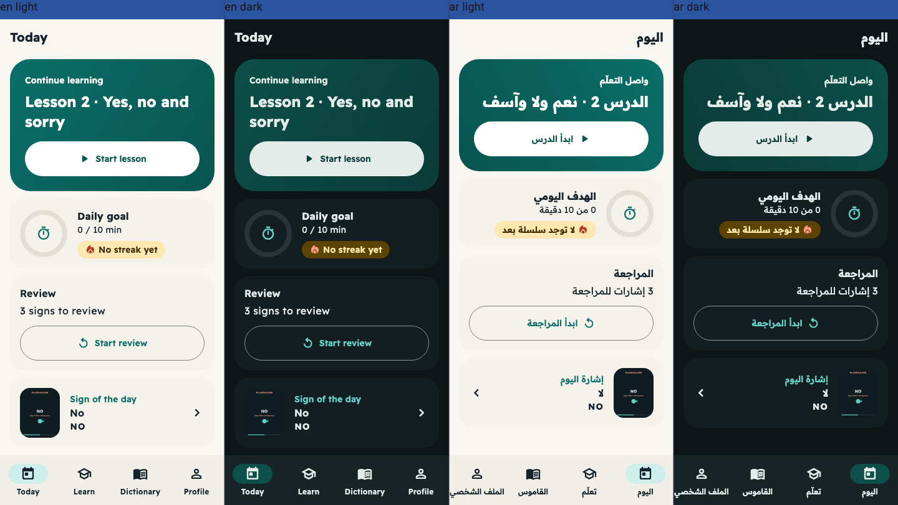
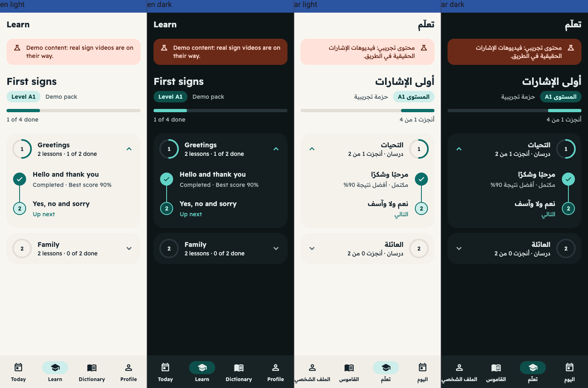
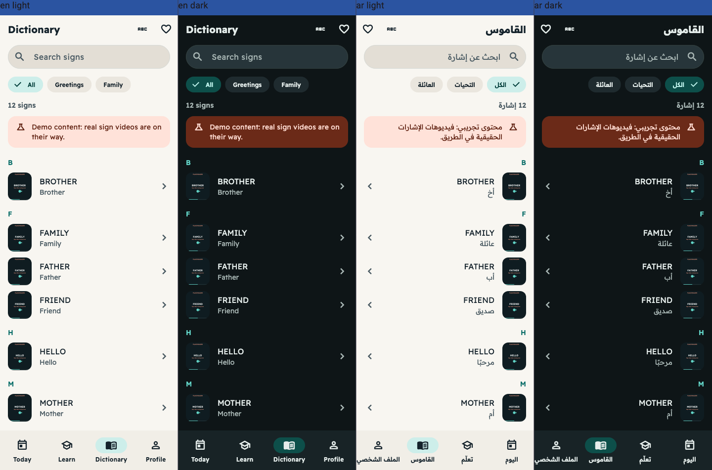
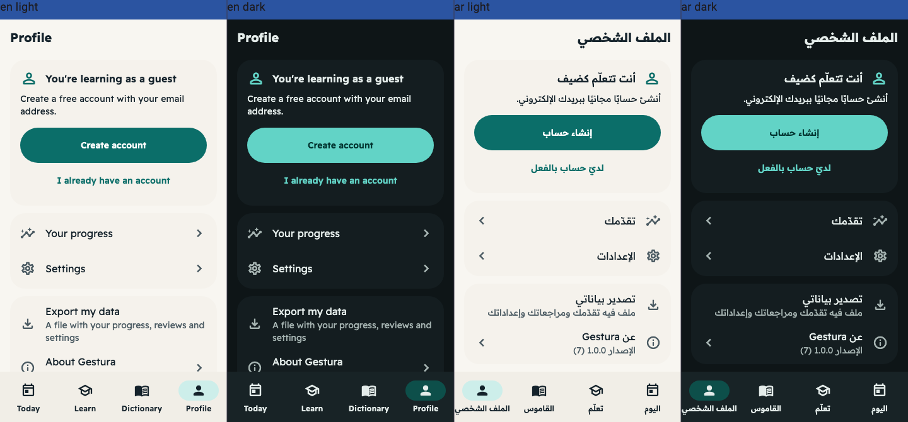

<h1 align="center">Gestura</h1>
<p align="center">Sign language, in your hands.</p>

<p align="center">
  <a href="https://github.com/Ziadabdellah/gestura/actions/workflows/ci.yml"></a>
  
  
  <a href="LICENSE"></a>
</p>

I'm building Gestura to help people learn the sign language of the country they live in. Short video lessons, a review system that brings signs back at the right time, and a dictionary that works offline. The app speaks English, Arabic, Russian, Spanish, French and German.

Every country has its own sign language, with its own grammar. Gestura is a companion for learning it, not a replacement for Deaf teachers and communities.

## Where it stands

The app works end to end. What's left before the first store release is the store listing, a closed test and the real sign videos. Right now the lessons use placeholder videos, and the app says so.

## Screenshots

<p align="center">
  
</p>

<p align="center">
  
</p>

<p align="center">
  
</p>

<p align="center">
  
</p>

<p align="center">
  
</p>

<p align="center">
  
</p>

These images are the golden files from the tests, so they always match the code.

## What's inside

- **Today**: your daily goal, streak, the next lesson, signs to review and a sign of the day.
- **Learn**: courses split into units. Finish a lesson to open the next one.
- **Lessons**: a looping video you can slow down, mirror or replay, then quick quizzes.
- **Review**: spaced repetition (SM-2). You rate each sign and it comes back when it should.
- **Dictionary**: search in any of the six languages, filter by category, save signs and share them.
- **Fingerspelling**: the alphabet, and any word spelled letter by letter.
- **Camera practice**: the sign on top, you on the bottom. Nothing is recorded.
- **Accounts**: start as a guest, then keep everything with Google or email. Export or delete your data any time.
- **Admin**: if you sign in with an admin email, the app opens a dashboard to add, edit, publish and delete content. Nobody else sees it.

## Design

Material 3 Expressive, with my own palette (Lagoon blue-green, coral and sun yellow) in light and dark. Readex Pro for Latin and Arabic, Golos Text for Cyrillic. The layout adapts to small and large phones and tablets, works right to left, and every color pair passes WCAG AA contrast.

## How it's built

```
gestura/
├── apps/gestura/         the Android and iOS app
└── packages/
    ├── gestura_core/     plain Dart logic
    └── gestura_ui/       the design system
```

- Flutter with a melos workspace.
- MVVM with Cubit, get_it and injectable, and go_router with typed routes.
- Drift for local data, Firebase for accounts, sync, config and crash reports.
- Three flavors (`dev`, `staging`, `prod`), all on one Firebase project.
- Published content lives on Firebase Hosting and is cached for offline use.

## Quality

- CI checks formatting, analysis and every test on each push.
- Unit, widget, golden and accessibility tests, plus integration tests on a simulator against the Firebase emulators.
- Every line the app owns is covered.

## Running it

You need [fvm](https://fvm.app).

```bash
fvm install
fvm flutter pub get
fvm dart run melos run gen --no-select
fvm dart run melos run test:flutter --no-select

cd apps/gestura
fvm flutter run --flavor dev -t lib/main_dev.dart
```

The Firebase config files aren't in the repo. Create your own project and run `flutterfire configure` for each flavor. The app IDs are `app.gestura.com.dev`, `app.gestura.com.stg` and `app.gestura.com`.

Integration tests:

```bash
firebase emulators:start --only auth,firestore --project <project-id>
cd apps/gestura
fvm flutter test integration_test --flavor dev
```

After a UI change, update the goldens with `fvm flutter test --flavor dev --update-goldens`. The Linux copies come from the **CI goldens** workflow on GitHub.

## License

The code is [MIT](LICENSE). The Gestura name and logo, the sign content and the fonts are not. See [NOTICE.md](NOTICE.md).
