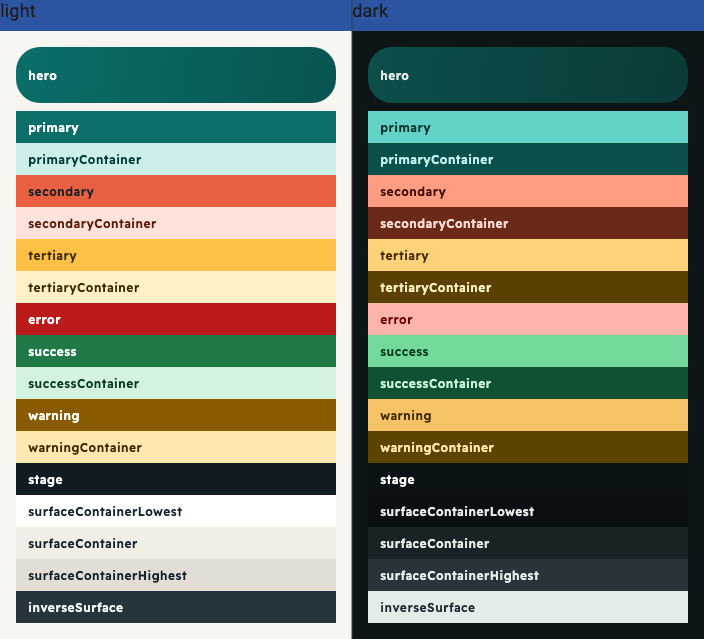

<h1 align="center">Gestura</h1>
<p align="center">Sign language, in your hands.</p>

<p align="center">
  <a href="https://github.com/Ziadabdellah/gestura/actions/workflows/ci.yml"></a>
  
  
  <a href="LICENSE"></a>
</p>

Gestura is a Flutter app, in development, that will teach the sign language of the European country you live in: short video lessons, spaced-repetition review and a dictionary that works offline. The interface will be available in English, Arabic, Russian, Spanish, French and German.

Every country has its own sign language, and each one is a full language with its own grammar. Gestura is meant as a learning companion, not a replacement for Deaf teachers and communities.

## Status

The project is built in phases. The foundation is in place:

| Part | What it is | Status |
|---|---|---|
| [`packages/gestura_ui`](packages/gestura_ui) | The design system: tokens, themes, fonts, components | Ready |
| [`packages/gestura_core`](packages/gestura_core) | Shared pure Dart logic | Ready |
| `apps/gestura` | The Android app | Next |

## Design system

<p align="center">
  
</p>

The images in this README are the golden files the tests compare against, so they always show the current code.

- **Palette.** A calm blue-green (Lagoon), a warm coral and a sun yellow, in light and dark themes. The brand colors are fixed, and every text and UI color pair is tested against WCAG 2.2 AA contrast.
- **Fonts.** Readex Pro for Latin and Arabic, with Golos Text as the fallback for Cyrillic. Both are bundled with the app, so no font is downloaded at runtime.
- **Adaptive scale.** The whole interface adapts to the phone it runs on, based on the screen's shortest side, so rotating the phone changes nothing:

  | Screen width | Text | Spacing and sizes |
  |---|---|---|
  | 320 dp | 100% | 90% |
  | 360 dp (design size) | 100% | 100% |
  | 412 dp | 112% | 114% |
  | 430 dp and wider | 112% | 115% |
  | Tablets | 100% | 100%, with a different layout instead |

  Text never shrinks below its design size, touch targets never drop below 48 dp, and the user's own text size setting is always applied on top.
- **Components.** `GButton`, `GCard`, `GChip`, `GSkeleton` and `GErrorView`, each with semantics labels, 48 dp touch targets, support for 200% text, reduced motion and right-to-left layouts.

<table>
  <tr>
    <td></td>
    <td></td>
  </tr>
</table>

## Shared logic

`gestura_core` is pure Dart, with no Flutter or Firebase:

- **`Result<T>`** (`Ok` and `Err`) and a sealed **`Failure`** hierarchy, so errors are handled with exhaustive `switch` expressions instead of exceptions.
- **`normalizeForSearch`** for search that ignores Arabic diacritics and hamza forms, folds Arabic-Indic digits, Russian ё and German ß, and collapses whitespace.

## Architecture

A monorepo with pub workspaces and [melos](https://melos.invertase.dev) 8:

```
gestura/
├── pubspec.yaml          workspace and melos scripts
└── packages/
    ├── gestura_core/     pure Dart logic
    └── gestura_ui/       design system
```

The app will follow MVVM, keep its data offline-first, and use Firebase for sync.

## Quality

- GitHub Actions runs formatting, analysis and every test on each push and pull request, and fails if a comment is added to the code.
- [very_good_analysis](https://pub.dev/packages/very_good_analysis) with `--fatal-infos`: zero warnings and zero infos.
- Unit and widget tests, accessibility guideline tests (tap targets, labels and text contrast) on small phones, large phones and tablets, and at 200% text.
- Golden tests in English and Arabic, in light and dark.
- 100% line coverage in both packages.

## Getting started

Requirements: [fvm](https://fvm.app). The Flutter version is pinned in [`.fvmrc`](.fvmrc).

```bash
fvm install
fvm flutter pub get
fvm dart run melos run analyze --no-select
fvm dart run melos run test:dart --no-select
fvm dart run melos run test:flutter --no-select
```

To update the golden files after a UI change:

```bash
cd packages/gestura_ui
fvm flutter test --tags golden --update-goldens
```

## License

The code is released under the [MIT License](LICENSE). The Gestura name and logo, the sign language content and the bundled fonts are not covered by it; see [NOTICE.md](NOTICE.md).
